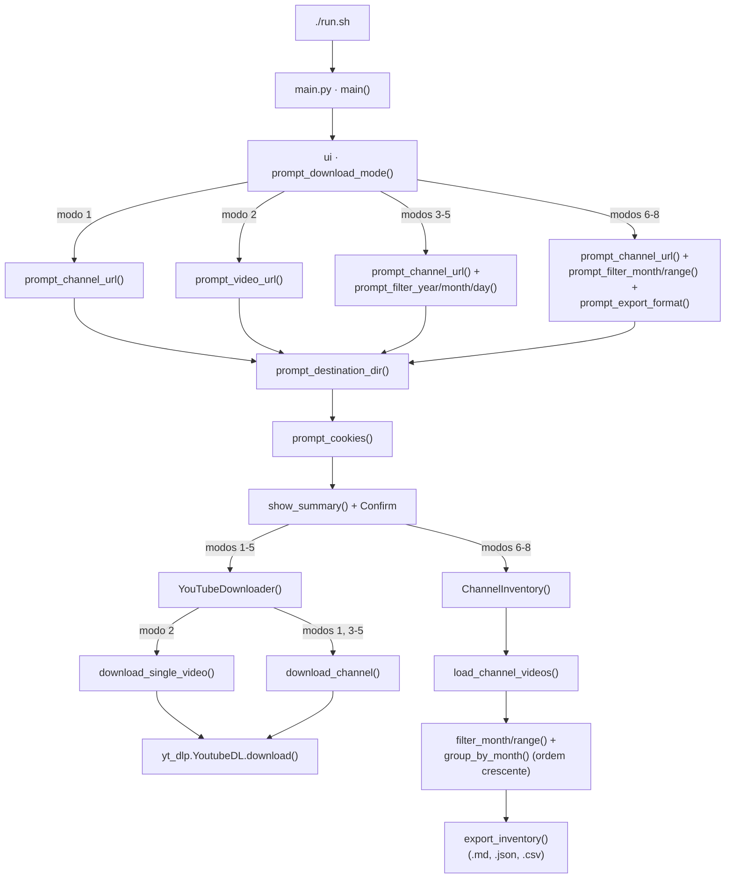

# 🔧 Manual Técnico — YouTube Channel Backup Downloader

> **Destinatários:** Programadores e colaboradores responsáveis pela manutenção do projeto.
> **Última atualização:** Novembro 2026

---

## 1. Visão Geral da Arquitetura

```
youtube-downloader/
├── main.py                  # Ponto de entrada — orquestra o fluxo completo
├── ui.py                    # Interface de terminal (Rich) + logger personalizado
├── downloader.py            # Motor de download (wrapper sobre yt-dlp)
├── inventory.py             # Motor de catálogo e exportação (.md, .json, .csv)
├── config.py                # Constantes, templates de caminho e parsers de datas
├── run.sh                   # Script de arranque (ativa venv + executa main.py)
├── requirements.txt         # Dependências Python
├── .gitignore               # Exclui .venv/, __pycache__/, vídeos e histórico
└── downloaded_archive.txt   # (gerado em runtime, não versionado) histórico de IDs
```

### Fluxo de execução



---

## 2. Descrição dos Módulos

### `config.py`

Responsável por constantes globais e validação/normalização de entradas de data.

| Símbolo | Tipo | Descrição |
|---------|------|-----------|
| `BASE_DIR` | `Path` | Diretório raiz do projeto |
| `DEFAULT_DOWNLOAD_DIR` | `Path` | `~/Videos/YouTube_Backups` |
| `ARCHIVE_FILE` | `Path` | `downloaded_archive.txt` (histórico de IDs) |
| `OUTPUT_TEMPLATE` | `str` | Template yt-dlp: `%(upload_date>%Y-%m\|sem-data)s/%(title)s [%(id)s].%(ext)s` |
| `normalize_channel_url(str)` | função | Normaliza o input do canal para `https://www.youtube.com/@X/videos` |
| `normalize_video_url(str)` | função | Normaliza ID ou link de vídeo individual |
| `parse_year(str)` | função | Devolve `(start_YYYYMMDD, end_YYYYMMDD, label)` |
| `parse_month(str)` | função | Aceita `AAAA-MM`, `MM-AAAA`, `MM/AAAA` ou `MM.AAAA`, trata anos bissextos |
| `parse_month_range(str, str)` | função | Valida início e fim e devolve `(start_YYYYMMDD, end_YYYYMMDD, lbl_inicio, lbl_fim)` |
| `parse_day(str)` | função | Aceita `AAAA-MM-DD`, `DD/MM/AAAA`, `AAAAAAMMDD` |
| `get_channel_slug(str)` | função | Extrai identificador seguro do canal para nomes de ficheiros |

> [!NOTE]
> O range de anos válidos está limitado a `2005–2035` em `parse_year()`, `parse_month()` e `parse_month_range()`. Ajusta se necessário.

---

### `inventory.py`

Módulo dedicado a catalogar, listar e exportar os vídeos do canal sem descarregar os ficheiros multimédia (`skip_download=True`).

#### Classe `ChannelInventory`

```python
ChannelInventory(
    cookie_browser: Optional[str] = None,
    logger: Optional[Any] = None,
)
```

**Principais métodos:**

| Método | Descrição |
|---|---|
| `load_channel_videos(channel_url, date_range, progress_callback)` | Extrai metadados de todos os vídeos do canal com ordenação cronológica crescente |
| `filter_month(videos, month_label)` | Filtra vídeos de um mês específico (`AAAA-MM`) |
| `filter_range(videos, start_month, end_month)` | Filtra vídeos dentro de um intervalo de meses |
| `group_by_month(videos)` | Agrupa vídeos num dicionário por mês (`AAAA-MM`) mantendo ordem crescente |
| `export_markdown(grouped, output_file, channel_name, filter_desc)` | Gera ficheiro `.md` estruturado com tabela e sumário |
| `export_json(grouped, output_file, channel_name, filter_desc)` | Gera ficheiro `.json` com metadados e estatísticas |
| `export_csv(grouped, output_file)` | Gera ficheiro `.csv` em UTF-8-BOM compatível com Excel |
| `export_inventory(...)` | Ponto de entrada unificado que exporta no formato pretendido (`md`, `json`, `csv` ou `all`) |

---

### `downloader.py`

Wrapper sobre o `yt_dlp.YoutubeDL`. Encapsula toda a lógica de configuração do motor de download.

#### Classe `YouTubeDownloader`

```python
YouTubeDownloader(
    destination_dir: Path,
    progress_callback: Optional[Callable],  # hook de progresso (fornecido por ui.py)
    cookie_browser: Optional[str],          # ex: "chrome", "firefox"
    date_range: Optional[DateRange],        # filtro de datas (yt_dlp.utils.DateRange)
    logger: Optional[Any],                  # instância de RichYDLLogger
)
```

**Opções relevantes do yt-dlp configuradas em `_get_ydl_options()`:**

| Opção yt-dlp | Valor | Motivo |
|---|---|---|
| `format` | `bestvideo[ext=mp4]+bestaudio[ext=m4a]/...` | Máxima qualidade em MP4 |
| `merge_output_format` | `mp4` | Forçar saída sempre MP4 |
| `outtmpl` | `<destino>/%(upload_date>%Y-%m)s/%(title)s [%(id)s].%(ext)s` | Organização por AAAA-MM |
| `download_archive` | caminho para `downloaded_archive.txt` | Evitar repetir downloads |
| `noplaylist` | `True` | Ignorar playlists aninhadas |
| `ignoreerrors` | `True` | Continuar mesmo com vídeos indisponíveis |
| `updatetime` | `True` | Preservar data de modificação do ficheiro = data de upload |
| `no_warnings` | `True` | Suprimir avisos de JS runtime e outros ruídos |
| `js_runtimes` | `{deno, node, quickjs, bun}` | Aceitar qualquer motor JS instalado |
| `sleep_interval_requests` | `2` | Pausa mínima (s) entre pedidos de metadados |
| `sleep_interval` | `2` | Pausa mínima (s) entre downloads |
| `max_sleep_interval` | `5` | Pausa máxima (s) com jitter aleatório |
| `daterange` | `DateRange(start, end)` | Apenas aplicado quando `apply_date_filter=True` |

> [!IMPORTANT]
> `download_single_video()` chama `_get_ydl_options(apply_date_filter=False)` — o filtro de data **não** é aplicado a vídeos individuais (o utilizador selecionou o vídeo explicitamente).

**Alias para retrocompatibilidade:**
```python
YouTubeChannelDownloader = YouTubeDownloader
```

---

### `ui.py`

Interface de terminal construída com a biblioteca `rich`. Contém:

- **Funções de prompt** — cada passo da configuração interativa
- **`print_progress_hook(d)`** — hook de progresso passado ao yt-dlp
- **`RichYDLLogger`** — logger personalizado injetado no yt-dlp

#### `RichYDLLogger`

Implementa a interface de logger do yt-dlp (`debug`, `info`, `warning`, `error`) e converte mensagens técnicas em inglês para feedback visual limpo em português.

| Método | Mensagens tratadas | Comportamento |
|--------|-------------------|---------------|
| `debug()` | `upload date is not in range` | Mostra `⏭ Vídeo ignorado (data fora do período)` |
| `debug()` | `has already been recorded in the archive` | Mostra `⏭ Já descarregado anteriormente: <título>` |
| `debug()` | `[download] Destination:` | Mostra `A preparar: <nome do ficheiro>` |
| `warning()` | `upload date is not in range` | Suprimido (duplicado do debug) |
| `warning()` | `No supported JavaScript runtime` | Mostra nota discreta sobre JS runtime |
| `warning()` | outros | Passa integralmente como `Aviso:` |
| `error()` | `rate-limited by YouTube` | Mensagem de alerta clara em português |
| `error()` | `Video unavailable` | Linha discreta com ID do vídeo |
| `error()` | outros | Passa integralmente como `Erro:` |

---

### `main.py`

Orquestra o fluxo completo:
1. Chama as funções de prompt de `ui.py` em sequência
2. Constrói `YouTubeDownloader` com todos os parâmetros
3. Chama `download_single_video()` ou `download_channel()` conforme o modo
4. Trata `KeyboardInterrupt` (Ctrl+C) e exceções genéricas

---

## 3. Dependências e Ambiente

### `requirements.txt`
```
yt-dlp>=2026.10.0
rich>=13.0.0
```

### Ambiente virtual (`.venv`)

O `.venv` aponta para o Python do sistema (`/usr/bin/python3`, versão 3.12).

> [!WARNING]
> O Ubuntu 24.04 não inclui o módulo `ensurepip` por omissão. O `.venv` **deve** ser criado com `--without-pip` e o `pip` instalado separadamente via `get-pip.py`.

**Procedimento de recriação completa do `.venv`:**
```bash
cd ~/Projetos/youtube-downloader

# 1. Remover o ambiente antigo
rm -rf .venv

# 2. Criar novo ambiente (sem pip)
python3 -m venv .venv --without-pip

# 3. Instalar pip via get-pip.py (requer internet)
curl -sSL https://bootstrap.pypa.io/get-pip.py | .venv/bin/python3

# 4. Instalar dependências do projeto
.venv/bin/pip install -r requirements.txt
```

### FFmpeg

Necessário para combinar streams de vídeo e áudio. Verificar se está instalado:
```bash
ffmpeg -version
```
Se não estiver:
```bash
sudo apt install ffmpeg
```

---

## 4. Ficheiro de Histórico (`downloaded_archive.txt`)

Gerado automaticamente na raiz do projeto. **Não está versionado no Git** (`.gitignore`).

**Formato:**
```
youtube abc123def456
youtube xyz789ghi012
```

Cada linha representa um vídeo já descarregado (`<extractor> <id>`). O yt-dlp verifica este ficheiro antes de cada download e ignora vídeos já presentes.

> [!CAUTION]
> Se eliminar este ficheiro, **todos os vídeos serão descarregados novamente** na próxima execução, incluindo os que já existem localmente.

**Para forçar o re-download de um vídeo específico**, remove a sua linha do ficheiro:
```bash
grep -v "abc123def456" downloaded_archive.txt > /tmp/archive.tmp && mv /tmp/archive.tmp downloaded_archive.txt
```

---

## 5. Organização de Ficheiros

O template de output do yt-dlp é:
```
%(upload_date>%Y-%m|sem-data)s/%(title)s [%(id)s].%(ext)s
```

- `%(upload_date>%Y-%m|sem-data)s` — formata a data de upload como `AAAA-MM`; se a data não estiver disponível usa `sem-data`
- `%(title)s` — título do vídeo (saneado automaticamente pelo yt-dlp)
- `%(id)s` — ID único do YouTube (11 caracteres), garante ausência de colisões de nomes
- `%(ext)s` — extensão final após pós-processamento (`mp4`)

**Resultado:**
```
<destino>/
  2024-03/
    O Meu Primeiro Vídeo [abc12345678].mp4
  2024-11/
    Tutorial de Python [xyz98765432].mp4
```

---

## 6. Rate-Limit do YouTube

O YouTube bloqueia sessões que fazem pedidos demasiado rápidos.

**Configuração atual de mitigação** (`downloader.py`):
```python
"sleep_interval_requests": 2,  # pausa entre pedidos de metadados (s)
"sleep_interval": 2,           # pausa mínima entre downloads (s)
"max_sleep_interval": 5,       # pausa máxima com jitter aleatório (s)
```

**Se ocorrer um rate-limit:**
1. Interrompe com `Ctrl+C`
2. Aguarda pelo menos 1 hora
3. Volta a executar — o histórico garante que não recomeça do início

**Para aumentar as pausas** (canais com muitos vídeos ou bloqueios frequentes), edita `downloader.py`:
```python
"sleep_interval_requests": 5,
"sleep_interval": 5,
"max_sleep_interval": 15,
```

---

## 7. Motor JavaScript (JS Runtime)

O yt-dlp usa motores JS para resolver os desafios *n-sig* do YouTube que desbloqueiam certos formatos de alta qualidade (ex: 4K).

**Runtimes suportados e detetados automaticamente:**

| Runtime | Executável | Como instalar |
|---------|-----------|--------------|
| Node.js | `node` | `sudo apt install nodejs` |
| Deno | `deno` | [deno.land/install.sh](https://deno.land/) |
| Bun | `bun` | [bun.sh](https://bun.sh/) |
| QuickJS | `qjs` | `sudo apt install quickjs` |

**Verificar o runtime ativo:**
```python
# No Python com o venv ativo:
import yt_dlp.globals, yt_dlp.jsinterp
print(yt_dlp.globals.supported_js_runtimes.value)
```

> [!NOTE]
> Sem qualquer runtime JS, o yt-dlp usa clientes alternativos (APIs móveis do YouTube). Os downloads funcionam, mas alguns formatos de muito alta qualidade podem não estar disponíveis.

---

## 8. Git e Controlo de Versões

```bash
# Estado atual
git log --oneline

# Enviar alterações para o GitHub
git add .
git commit -m "descrição da alteração"
git push origin main
```

**Commits no histórico:**

| Hash | Descrição |
|------|-----------|
| `fad8459` | fix: suprimir avisos JS runtime e adicionar sleep anti-rate-limit |
| `75d3032` | fix: habilitar runtimes JS e suavizar mensagem de aviso na UI |
| `7408023` | feat: adicionar opções de descarga por tudo, vídeo individual, ano, mês e dia |
| `98bf65c` | feat: initial commit for youtube channel backup downloader |

---

## 9. Atualizar o `yt-dlp`

O `yt-dlp` é atualizado frequentemente para acompanhar mudanças na API do YouTube. Se os downloads deixarem de funcionar, atualiza primeiro:

```bash
cd ~/Projetos/youtube-downloader
source .venv/bin/activate
pip install --upgrade yt-dlp
```

Depois atualiza o `requirements.txt`:
```bash
pip freeze | grep yt-dlp > requirements.txt
echo "rich>=13.0.0" >> requirements.txt
```

---

## 10. Adicionar um Novo Modo de Filtro

Para adicionar um novo modo (ex: "Filtrar por intervalo de datas"):

1. **`config.py`** — adicionar a função de parsing e validação do novo input
2. **`ui.py`** — adicionar linha na tabela de `prompt_download_mode()` e criar função `prompt_filter_<nome>()`
3. **`main.py`** — adicionar `elif mode == "X":` no bloco de seleção de modo
4. **`downloader.py`** — normalmente não precisa de alterações; o `DateRange` do yt-dlp suporta qualquer intervalo

---

## 11. Executar em Servidor / Sem UI Interativa

Para executar sem prompts (modo não interativo), cria um script wrapper:

```python
# run_headless.py — exemplo de uso programático
import sys
sys.path.insert(0, '/home/dapb/Projetos/youtube-downloader')
from pathlib import Path
from downloader import YouTubeDownloader
from yt_dlp.utils import DateRange

dl = YouTubeDownloader(
    destination_dir=Path('/mnt/c/Users/dapb/Videos/YouTube_Backups'),
    date_range=DateRange('20241101', '20241130'),  # Novembro 2024
)
dl.download_channel('@MeuCanal')
```

```bash
source .venv/bin/activate
python3 run_headless.py
```

---

## 12. Contacto e Manutenção

| Item | Detalhe |
|------|---------|
| Repositório | `git@github.com:<utilizador>/youtube-downloader.git` |
| Linguagem | Python 3.12 |
| SO testado | Ubuntu 24.04 LTS (WSL2 no Windows 11) |
| Dependência crítica | [yt-dlp](https://github.com/yt-dlp/yt-dlp) — verificar releases regularmente |
| Documentação yt-dlp | [github.com/yt-dlp/yt-dlp/wiki](https://github.com/yt-dlp/yt-dlp/wiki) |
